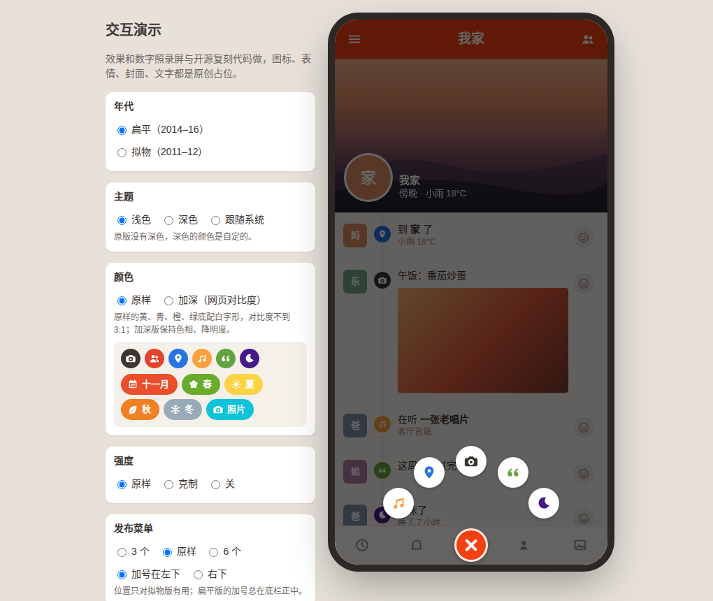
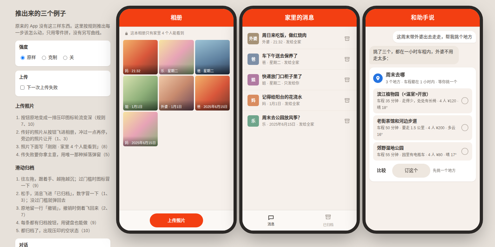

# path-ui

[](https://github.com/rowline/path-ui/releases)
[](https://github.com/rowline/path-ui/actions/workflows/ci.yml)
[](LICENSE)
[](SKILL.md)

A reusable Agent Skill for rebuilding the tactile UI and motion feel of **Path** (the private social journal app, 2010–2018) on the web — the arc-burst `+` menu, scrollbar clock, type-dot timeline, in-place emotion picker, swinging drop modals — and extending its principles to modern interfaces, full-site design systems, UI reviews, and AI chat result cards. Timings and colours are measured from screen recordings; the bundled kit is zero-dependency JS/CSS with TypeScript declarations. Docs are written in Chinese.

一个面向 AI 编码助手的标准化 Skill：在网页上复刻 **Path（2010–2018）**「平静纸面 + 有重量的克制动效 + 就地完成小事」的界面与交互手感，并按这套规则推演 Path 没做过的表单、列表、详情页、全站设计系统、已有界面审改与 AI 对话结果卡。

---

## 效果预览

| 复刻演示（`assets/path-kit/demo.html`） | 延伸示范（`assets/path-kit/extend-demo.html`） |
| --- | --- |
|  |  |

本地直接起服务体验：

```bash
cd assets/path-kit
python3 -m http.server 5181
```

打开 `http://localhost:5181/demo.html`（切时代、深浅主题、对比度增强、强度与菜单布局）和 `http://localhost:5181/extend-demo.html`（上传照片、滑动归档、和助手说结果卡）。

---

## 安装

### 方式一：下载独立安装包（推荐）

从 [GitHub Releases](https://github.com/rowline/path-ui/releases) 下载 `path-ui.skill`（标准 ZIP 归档，已自动剔除 `evals/` 与 `vendor-skills/`），解压到对应客户端的 skills 目录（文件夹名保持 `path-ui`）：

| 客户端 | 个人全局目录 | 项目级目录 |
| --- | --- | --- |
| **Claude Code** | `~/.claude/skills/path-ui/` | `<项目>/.claude/skills/path-ui/` |
| **Antigravity** | `~/.gemini/config/skills/path-ui/` | `<项目>/.agents/skills/path-ui/` |
| **Codex** | `~/.codex/skills/path-ui/` | `<项目>/.codex/skills/path-ui/` |
| **Cursor / 其他 `agentskills.io` 客户端** | 按客户端 skills 目录放置 `path-ui/` | `<项目>/.agents/skills/path-ui/` |

> [!TIP]
> 已包含 [agents/openai.yaml](agents/openai.yaml)，Codex 可直接读取展示名称、品牌色 `#F33F12`、默认调用提示与触发策略。

### 方式二：从源码仓库克隆 / 本地打包

```bash
git clone https://github.com/rowline/path-ui.git
cd path-ui
python3 scripts/package_skill.py -o dist/path-ui.skill
```

将打包产出的内容解压安装即可。**注意**：如果直接把整份 Git 仓库放进 skills 目录，`vendor-skills/` 内的三份参考 `SKILL.md` 也会被部分客户端扫描加载；仅使用 `path-ui` 时，请使用 `path-ui.skill` 安装包或删掉复制后的 `vendor-skills/`。

装好以后，在对话中提到 **Path**、「像 Path 那样的效果 / 思路」、扇形弹出的加号菜单、滚动时间标签、掉落弹窗、AI 对话结果卡，或在 Codex 中显式使用 `$path-ui` 时，Agent 就会按需加载本规范。

---

## 仓库内容

| 目录 / 文件 | 用途 |
| --- | --- |
| [SKILL.md](SKILL.md) | Skill 入口：意图识别、System Map、14 条规则速查、五级动作、工作流、分形态输出契约与硬性底线 |
| [agents/openai.yaml](agents/openai.yaml) | Codex / OpenAI UI 元数据与隐式调用策略 |
| [references/essence.md](references/essence.md) | 七条取向、两代骨架、十个模式、十四条规则与「推一个新东西」六步 |
| [references/design-system.md](references/design-system.md) | 独立项目全站规范：双主题三层表面、字号圆角、非原生选择器、表格、弹窗与多页验收 |
| [references/review-checklist.md](references/review-checklist.md) | 交付前 15 条快速自查、审已有界面方法与七类高频实战陷阱 |
| [references/existing-ui.md](references/existing-ui.md) | 改已有界面的保护流程（先跑通原样、功能路径表、分清模拟）与工程师规格表 |
| [references/ai-views.md](references/ai-views.md) | AI 对话里的卡片与工作面（一眼与点开、数据进话出、四态与安全底线） |
| [references/motion-spec.md](references/motion-spec.md) | 逐帧实测与开源复刻的时长、弹簧、颜色、强度与零件默认值 |
| [references/porting.md](references/porting.md) | 单文件 / 原生 / React+TS / Tailwind / 已有系统接入方法与相对时间锚点 |
| [assets/path-kit/](assets/path-kit/path-kit.js) | 零依赖 JS/CSS 与 `path-kit.d.ts`（动作零件、10+ 交互组件、17 个原创实心字形）及双 Demo |
| [scripts/](scripts/validate_skill.py) | `validate_skill.py`（全项校验）、`package_skill.py`（打包）、`inline_kit.py`（单文件内联）、`check_prototype.py`（静态底线）、`contrast.py`、`motion-probe.js`、`frame-sheet.js` |
| [evals/](evals) | 17 组评测用例（覆盖复刻、延伸表单/详情/AI 卡片与已有界面审查），不进分发安装包 |
| [CHANGELOG.md](CHANGELOG.md) | 版本变更记录 |

---

## 校验与打包

仓库内置一键校验与可复现打包脚本（需 Python 3.10+，`validate_skill.py` 另需 `PyYAML`）：

```bash
# 全量校验：frontmatter、openai.yaml、相对链接、evals、Demo 静态底线与打包完整性
python3 scripts/validate_skill.py

# 生成标准 .skill 安装包（默认输出 dist/path-ui.skill）
python3 scripts/package_skill.py

# 交付单文件 HTML 前的常用工具
python3 scripts/inline_kit.py page.html
python3 scripts/check_prototype.py page.html
python3 scripts/contrast.py --on '#0ec2d8'
```

GitHub Actions 会在每次推送 `main` 时自动运行校验，在推送 `v*` tag 时自动构建并附带 `path-ui.skill` 发布 Release。

---

## 先知道的几件事

- **不含 Path 的品牌资产**：标志、字标、贴纸、原图标和照片均未收录；demo 里的图标、字形和表情均为原创简笔画。复刻的是行为、节奏和结构，素材在线参考地址仅列于 [references/essence.md](references/essence.md) 末尾。
- **规则是归纳出来的**：14 条规则是从录屏、截图和开源实现反推整理而成，不是 Path 官方设计原则。
- **扇形发布菜单有有效专利**：Path 的「从菜单图标沿路径弹出子图标」受美国专利 **US9448692B1**（现由 Kakao 持有，预计 2034-07-16 到期）保护。做原型与学习没有问题；用于上线的商用产品前，请先咨询法务评估，或改用 [references/design-system.md](references/design-system.md) 中的非沿弧线展开方案。
- **无关联声明**：Path 是 Kakao 旗下已停止服务的产品，本项目与 Path、Kakao 没有关联。

---

## 吸收自

`vendor-skills/` 原样存档了 [JUNERDD/Atd](https://github.com/JUNERDD/Atd) 的三个 UI skill（MIT，版权见 [vendor-skills/LICENSE](vendor-skills/LICENSE)），不打入安装包。`path-ui` 从中吸收并按 Path 规则重写了以下方法：

- **apple-design**：控件状态模型（规则 14：按下即反应、松手执行、选中不只靠颜色、禁用可见并说明原因、忙碌放进控件内）；减少动效替换为淡入淡出而非直接删除反馈；加载延迟露面并留够时间；能撤销就不弹确认；对比度与点击区量化测量；快速自查与问题清单写法。
- **high-fidelity-prototype**：改已有界面前先跑通原样、只改目标范围、列功能路径表、分清真实接口与模拟状态、演示控件与产品控件分离。
- **generative-ui**：AI 对话何时出卡、对话里「一眼」与点开后「工作面」的分层、数据进话出、请求收口、外观从内容类型来、满/空/错/忙四态以及安全底线（不要密码、不仿冒授权、外来内容只当文本）。有一处相反：Atd 小卡不放控件，而 `path-ui` 遵循「小事就地做完」，一步能完成的动作直接留在卡片上。

未吸收的部分：毛玻璃材质（与 Path 不透明暖纸面相反）、苹果「点按不弹」（与 Path 的「冒一下」冲突，由强度参数统一调节）、原生 SwiftUI / 苹果系统控件尺寸、generative-ui 的私有调用接口（`show_ui` / `update_ui`）以及 macOS 字号表。

---

## 许可证

MIT，见 [LICENSE](LICENSE)。许可证适用于本仓库的代码与文档；Path 的名称、商标与原始素材归原权利人所有，不在授权范围内。
